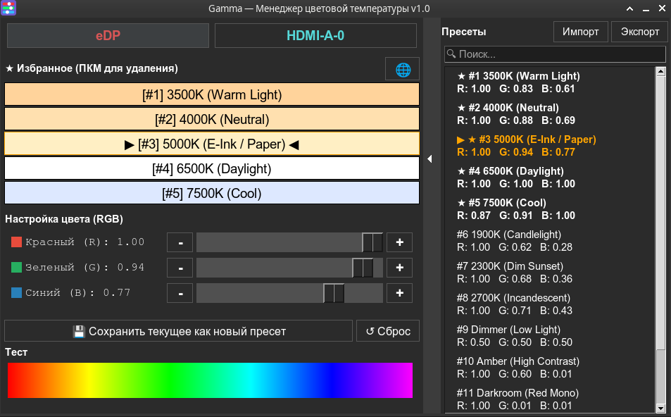
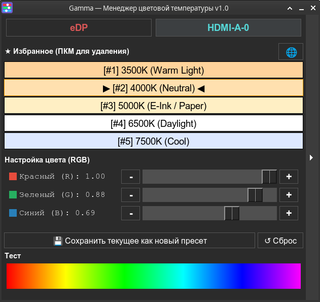

# Gamma — Color Temperature Manager

**English** | [Русский](README.ru.md)

A simple **X11** utility for manual control of monitor color temperature presets. Written in Python and Tkinter, requires no background processes or external dependencies.


| Main window (with presets panel) | Compact mode (presets panel hidden) |
|:---:|:---:|
|  |  |

> ⚠️ **Important:** Gamma works **only on X11**. The utility does not function on Wayland because `xrandr` has no access to gamma control. For Wayland, use Gammastep or the built-in Night Light.

## 🎯 Who is Gamma for?

**Gamma is ideal if you:**
- Use **X11** (not Wayland)
- Prefer **manual control** over automatic transitions
- Want **minimal dependencies** — only Python + xrandr
- Need a **portable solution** without system installation
- Use **i3wm, bspwm, AwesomeWM** and want to bind hotkeys
- Have **several different monitors** that need color balancing
- Value **simplicity** and code transparency

**Gamma is NOT for you if you:**
- Use **Wayland** (need Gammastep or built-in Night Light)
- Want **automatic switching** by time of day (need Redshift/f.lux)
- Need **geolocation** for automatic sunset/sunrise calculation

## 🎯 Real advantages

### Zero Configuration
The program doesn't need to know where you are, what time it is, or whether you have internet. You download it, launch it — and immediately have ready buttons with understandable temperatures (2700K, 3500K, etc.). No need to look up coordinates, write `redshift.conf`, or deal with geoclue.

### Independent monitor configuration
If you have several different monitors (e.g., a laptop IPS screen and an external TN monitor), they "out of the box" produce completely different images. Gamma allows you to:
- **Compensate for poor calibration** — adjust RGB gamma for each monitor so white looks the same on all of them
- **Use separate presets** — main monitor warm for code reading (3500K), second in neutral tones (5000K) for references
- **Save complex configuration** to a single JSON file that survives session restarts

Unlike Redshift, which applies settings globally to the entire X session, or Night Light, which works on a "one slider for everything" principle, Gamma gives full control over each display via GUI.

### Smart restoration without daemons
Gamma settings for all monitors are automatically restored on login. The program does this in a fraction of a second at session start and immediately exits, without staying in memory.

### One-click automation
You don't need to manually edit `.xprofile` or window manager files. The included `autostart-enable.sh` script sets up autostart with a single command.

### Human-friendly interface
Unlike Redshift, where creating presets requires writing bash wrapper scripts, Gamma has a Tkinter GUI where you can save the current profile, rename it, or delete it in one click.

### Portability
Gamma is a ready-to-run script. No need to build from source or add third-party PPAs. You can carry it on a flash drive and run on any X11 system.

### Perfect for scripting
Thanks to the full-featured CLI, the program is convenient to bind to window manager hotkeys (i3wm, bspwm, AwesomeWM) for quick mode switching (e.g., `Super+F1` — day, `Super+F2` — night).

## ✨ Features

### Core functions
- **Presets** — 12 built-in presets (1900K–7500K + special modes) + create your own
- **Preset comments** — description of each preset's purpose with hover tooltips
- **Quick favorites** — 5 slots for frequently used presets with color indication; the 🌐 button applies current values to all monitors at once
- **Multi-monitor support** — independent settings for each
- **CLI for hotkeys** — apply presets from terminal
- **Import/Export** — share presets via JSON
- **Autostart** — restore settings on login (one-shot, no daemon)
- **Bilingual interface** — Russian/English
- **Config backup** — automatic `.bak` saving
- **Preset editing** — unified form to edit a preset's name, comment, and RGB values (with `ttk.Spinbox` for precise 0.00–1.00 input)
- **Gamma reset** — quick button to return to neutral RGB(1.0, 1.0, 1.0) for the current monitor

### Interface & UX
- **Flat design** — modern flat interface without outdated 3D frames
- **Auto theme detection** — automatic switching between dark and light system themes
- **DPI scaling** — HiDPI auto-detection (via `GDK_SCALE`, `Xft.dpi`, or monitor's physical DPI via `xrandr`) with automatic font and widget scaling; the chosen scale is saved to config and can be changed at runtime via `Ctrl++`/`Ctrl+-`/`Ctrl+0`
- **GUI hotkeys** — `Ctrl+S` (save), `Ctrl+I`/`Ctrl+E` (import/export), `Ctrl+F` (focus search), `Ctrl++`/`Ctrl+-`/`Ctrl+0` (UI scale), `Ctrl+Shift+A` (apply to all monitors), `1`–`5` (favorite slots), `Escape` (close window)
- **Channel color indicators** — small R/G/B colored squares next to sliders for quick visual reference
- **Thick slider trough** — increased trough thickness for easier mouse grabbing
- **Visual markers** — ★ for favorite presets, ▶ ◀ for active
- **Active preset highlight** — orange text in the preset panel for the current preset
- **Themed dialogs** — custom message boxes instead of standard messagebox
- **Native file dialogs** — via zenity (optional, if available) to match system theme; falls back to built-in tkinter dialogs without it
- **Tooltips with comments** — hover hints with preset descriptions
- **Colored favorite buttons** — each button tinted with its preset's color

## 🎨 Built-in presets

| ID | Name | RGB | Purpose |
|----|------|-----|---------|
| 1 | 3500K (Warm Light) | 1.00, 0.83, 0.61 | Warm white for low-light work |
| 2 | 4000K (Neutral) | 1.00, 0.88, 0.69 | Neutral white without yellow tint |
| 3 | 5000K (E-Ink / Paper) | 1.00, 0.94, 0.77 | E-paper effect for reading |
| 4 | 6500K (Daylight) | 1.00, 1.00, 1.00 | Standard sRGB D65 profile |
| 5 | 7500K (Cool) | 0.87, 0.91, 1.00 | Cool light for contrast |
| 6 | 1900K (Candlelight) | 1.00, 0.62, 0.28 | Candlelight for late night |
| 7 | 2300K (Dim Sunset) | 1.00, 0.68, 0.36 | Soft amber light for relaxation |
| 8 | 2700K (Incandescent) | 1.00, 0.71, 0.43 | Classic incandescent bulb |
| 9 | Dimmer (Low Light) | 0.50, 0.50, 0.50 | 50% brightness reduction |
| 10 | Amber (High Contrast) | 1.00, 0.60, 0.01 | High contrast mode |
| 11 | Darkroom (Red Mono) | 1.00, 0.01, 0.01 | Monochrome red for darkroom |
| 12 | Eco (Green Tint) | 0.30, 1.00, 0.30 | Green filter for low brightness |

## 📋 CLI usage examples

### Apply a preset from a favorite slot

```bash
$ ./gamma.py --slot 2
✅ Applied: 3500K (Warm) (RGB: 1.00, 0.83, 0.61) to monitor eDP-1
```

### List available monitors

```bash
$ ./gamma.py --monitors

📺 Available monitors (2):
==================================================
  1. eDP-1
     Mode: 1920x1080+0+0
  2. HDMI-A-0
     Mode: 1920x1080+1920+0
==================================================

💾 Saved gamma settings:
  ✓ eDP-1: RGB 1.00, 0.83, 0.61
  ✓ HDMI-A-0: RGB 1.00, 1.00, 1.00

🎯 Current monitor: eDP-1
```

### Cyclic preset switching

```bash
$ ./gamma.py --next
✅ Applied: 2700K (Incandescent) (RGB: 1.00, 0.71, 0.43) to monitor eDP-1
```

### Apply by name or ID

```bash
$ ./gamma.py --preset "6500K (Daylight)"
$ ./gamma.py --preset 4
```

### Working with multiple monitors

```bash
# Configure the external monitor
$ ./gamma.py --slot 3 --monitor HDMI-A-0
✅ Applied: 4000K (Neutral) (RGB: 1.00, 0.88, 0.69) to monitor HDMI-A-0

# Apply a preset to ALL monitors at once
$ ./gamma.py --slot 1 --all
🎯 Applying '3500K (Warm Light)' to all monitors...
✅ Applied: 3500K (Warm Light) (RGB: 1.00, 0.83, 0.61) to monitor eDP
✅ Applied: 3500K (Warm Light) (RGB: 1.00, 0.83, 0.61) to monitor HDMI-A-0
```

### Restore on autostart

```bash
$ ./gamma.py --restore
⏳ Waiting 3s for monitors...
✅ eDP-1: 3500K (Warm) (RGB: 1.00, 0.83, 0.61)
✅ HDMI-A-0: 6500K (Daylight) (RGB: 1.00, 1.00, 1.00)
```

### Hotkeys (i3wm example)

In `~/.config/i3/config`:
```bash
bindsym $mod+F1 exec ~/bin/gamma/gamma.py --slot 1
bindsym $mod+F2 exec ~/bin/gamma/gamma.py --slot 2
bindsym $mod+F3 exec ~/bin/gamma/gamma.py --next
```

## 🔄 Honest comparison with alternatives

| | **Gamma** | **Redshift** | **Gammastep** | **GNOME Night Light** |
|---|---|---|---|---|
| **Purpose** | Manual preset switcher | Automatic time-based switching | Automatic time-based switching | Automatic schedule-based switching |
| **Per-monitor configuration** | ✅ Full (individual RGB per monitor in GUI and CLI via `--monitor`) | ❌ No (applies globally to all outputs) | ❌ No (applies globally to all outputs) | ❌ No (one slider for all screens) |
| **Ready to use (UX)** | ✅ Out of the box (launch — 12 presets ready, click a preset — applied) | ⚠️ Manual mode via CLI (`-O`); auto-mode requires geoclue | ⚠️ Manual mode via CLI (`-O`); auto-mode requires geoclue | ✅ Out of the box (but tied to geolocation/time) |
| **Preset management** | ✅ GUI + CLI (save, import/export, search) | ⚠️ CLI (`-O`) + third-party tray GUI (redshift-gtk) | ⚠️ CLI (`-O`) + third-party tray GUI (gammastep-indicator) | ❌ No (auto mode only) |
| **Background process** | ❌ No (one-shot, apply and exit) | ✅ Daemon (always in memory) | ✅ Daemon (always in memory) | ✅ DE service (always in memory) |
| **Wayland support** | ❌ X11 only | ❌ No (project abandoned) | ⚠️ Limited (wlroots only: Sway, Hyprland; not GNOME/KDE) | ✅ Yes |
| **Format** | Script (runs directly, no installation) | Package (requires build/install) | Package (requires build/install) | Built into GNOME |
| **Availability** | ❌ Manual (download from repository) | ✅ In distribution repositories | ✅ In distribution repositories | ✅ Built into GNOME |
| **Dependencies** | Python + xrandr | C (geoclue optional for auto-coordinates) | C (geoclue optional for auto-coordinates) | Built into GNOME |
| **Preset import/export** | ✅ JSON files | ❌ No | ❌ No | ❌ No |
| **Preset comments** | ✅ Yes | ❌ No | ❌ No | ❌ No |
| **Dark/light theme** | ✅ Auto-detection | ❌ No | ❌ No | ✅ Yes |

**Choosing a utility:**
- **Gamma** — if you need a simple manual switcher with GUI and presets for X11, especially with multiple monitors
- **Redshift/Gammastep** — if you need automatic time/sunset-based switching
- **Night Light** — if you use GNOME on Wayland

## 🚀 Installation

### Requirements

- **X11** (not Wayland)
- Python 3.10+ (for built-in generics `list[X]`, `X | None`, and `match/case`)
- `xrandr`
- `python3-tk` (or `python3-tkinter` / `tk` depending on distribution)
- `zenity` (optional — for native import/export dialogs matching the system theme; falls back to built-in tkinter dialogs without it)

**Installing dependencies on Debian/Ubuntu:**
```bash
sudo apt install python3 python3-tk xrandr  # zenity — optional
```

**On Fedora/RHEL:**
```bash
sudo dnf install python3 python3-tkinter xrandr  # zenity — optional
```

**On Arch Linux:**
```bash
sudo pacman -S python tk xorg-xrandr  # zenity — optional
```

### Quick install

```bash
cd ~/bin/gamma/
./install.sh
```

The `install.sh` script:
1. **Checks dependencies** — `python3`, `xrandr`, `python3-tk` (suggests install command if missing)
2. **Checks files** — ensures `gamma.py` is present, makes it executable (`chmod +x`)
3. **Creates `.desktop` file** — `~/.local/share/applications/gamma.desktop` (Gamma appears in applications menu)
4. **Installs icon** — copies `gamma.png` to `~/.local/share/icons/`
5. **Updates cache** — `update-desktop-database` + `gtk-update-icon-cache`

> No `sudo` required — installs to home directory (`~/.local/share/`). If Gamma is already installed, asks for reinstall confirmation.

### Uninstall

```bash
cd ~/bin/gamma/
./uninstall.sh
```

The `uninstall.sh` script:
1. **Shows list of files** to be removed
2. **Asks for confirmation** `[y/N]`
3. **Removes `.desktop` file** — `~/.local/share/applications/gamma.desktop`
4. **Removes icon** — `~/.local/share/icons/gamma.png`
5. **Updates cache** of applications

> Settings and presets (`gamma_config.json`) are **not removed** — they stay in the script folder in case of reinstallation.

### Via Make

```bash
make install      # Install
make uninstall    # Remove
make run          # Run
```

## 🖥️ Usage

### Graphical interface

```bash
./gamma.py
```

**Interface:**
- **Left**: monitor selection, favorite slots with 🌐 button (apply to all), RGB sliders with channel color indicators, "Save" and "Reset" buttons, test color strip
- **Right**: preset panel with search and tooltip hints
- **Context menu** (right-click on a preset): add to favorites, **edit** (name + comment + RGB via Spinbox), delete
- **Theme**: automatically detected from GTK system settings
- **DPI scaling**: HiDPI auto-detected (via `GDK_SCALE`, `Xft.dpi`, or monitor's physical DPI), scale is saved to config and can be changed at runtime via `Ctrl++`/`Ctrl+-`/`Ctrl+0`

### GUI hotkeys

| Shortcut | Action |
|----------|--------|
| `Ctrl+S` | Save current values as a new preset |
| `Ctrl+I` | Import presets from JSON |
| `Ctrl+E` | Export presets to JSON |
| `Ctrl+F` | Focus the search field (selects all text) |
| `Ctrl++` | Increase UI scale by 0.25 (max 3.0) |
| `Ctrl+-` | Decrease UI scale by 0.25 (min 0.75) |
| `Ctrl+0` | Reset UI scale to auto-detected DPI |
| `Ctrl+Shift+A` | Apply current values to all monitors |
| `1`–`5` | Activate favorite slot (1–5) |
| `Escape` | Close the window |

> Digit keys `1`–`5` work even when the search field has focus. When a dialog window is open (edit/save preset), hotkeys are blocked to avoid interfering with text input.

> The UI scale is saved in `gamma_config.json` (`ui_settings.ui_scale`) and applied on the next launch on any monitor. `Ctrl+0` resets to auto-detect — on the next launch, the scale will be re-detected from the current monitor's DPI and saved.

### Command line

```bash
./gamma.py --slot 1           # Apply slot 1
./gamma.py --next             # Next preset
./gamma.py --preset 6500K     # By name
./gamma.py --slot 1 --all     # Apply to all monitors
./gamma.py --monitors         # List monitors
./gamma.py --restore          # Restore settings
./gamma.py --help             # Help
```

## 🔄 Autostart

Gamma can automatically restore the last gamma settings on login. This is a **one-shot** operation: the program launches, applies gamma to all monitors, and immediately exits — no daemon in memory.

### Enable autostart

```bash
./autostart-enable.sh
```

Creates `~/.config/autostart/gamma-restore.desktop` that runs `gamma.py --restore` on login.

### Disable autostart

```bash
./autostart-disable.sh
```

### How it works

1. On login, the DE/WM runs `gamma.py --restore`
2. The program detects all connected monitors
3. For each monitor, the saved gamma is applied (or the last used one)
4. The program **exits** — nothing stays in memory
5. Settings are saved for future use

### Adjusting the delay

If external monitors initialize slowly, edit the created `~/.config/autostart/gamma-restore.desktop` and add the `--delay` flag:

```ini
Exec=/home/username/bin/gamma/gamma.py --restore --delay 10
```

Or use an environment variable for flexibility:

```bash
./gamma.py --restore --delay ${GAMMA_DELAY:-5}
```

## 📁 Project structure

```
gamma/
├── gamma.py                  # Main application
├── gamma_presets.json        # Built-in presets
├── gamma.png                 # Icon (PNG)
├── gamma.svg                 # Icon (SVG)
├── gamma.desktop             # Desktop entry
├── install.sh                # Installation
├── uninstall.sh              # Uninstallation
├── autostart-enable.sh       # Enable autostart
├── autostart-disable.sh      # Disable autostart
├── Makefile                  # install / uninstall / run / test / clean
├── README.md                 # Documentation (English)
├── README.ru.md              # Documentation (Russian)
├── CHANGELOG.en.md
├── CHANGELOG.ru.md
├── CONTRIBUTING.md           # How to report bugs and contribute
├── LICENSE
├── docs/                     # Screenshots
│   ├── screenshot-main.png   # Main window with presets panel
│   └── screenshot-compact.png
├── .github/
│   └── ISSUE_TEMPLATE/       # Bug report template
└── .gitignore
```

> `gamma_config.json`, `gamma_config.json.bak` and `gamma.log` are created in this folder at runtime and are ignored by Git.

## ⚙️ Configuration

`gamma_config.json`:
```json
{
  "ui_settings": {
    "language": "en",
    "right_panel_visible": true,
    "window_geometry": "760x500+100+100"
  },
  "system_settings": {
    "monitor": "eDP-1",
    "monitor_gammas": {
      "eDP-1": [1.00, 0.83, 0.61],
      "HDMI-A-0": [1.00, 1.00, 1.00]
    },
    "last_rgb": [1.00, 0.83, 0.61]
  },
  "presets": [
    {
      "id": 1,
      "name": "3500K (Warm Light)",
      "rgb": [1.00, 0.83, 0.61],
      "comment": "Warm white for low-light work"
    }
  ],
  "favorites": [1, 2, 3, 4, 5]
}
```

**Preset fields:**
- `id` — unique identifier
- `name` — display name
- `rgb` — gamma values [R, G, B] in the 0.01–1.0 range
- `comment` — preset description (shown in tooltip)

**Backup:** `.bak` is created automatically on every save.

> **Note:** Built-in presets are calculated using the Planckian chromaticity scale (Tanner Helland's algorithm). If your monitor distorts colors natively, you can adjust the coefficients in the GUI and save them to a user JSON profile via "Import/Export".

## 📝 Logging

`gamma.log` with **rotation** (3 backup copies of 1 MB each, format `gamma.log.1`, `gamma.log.2`, `gamma.log.3`).

```bash
tail -n 50 gamma.log
grep ERROR gamma.log
```

**What gets logged:**
- Application launch and mode selection (GUI/CLI)
- Gamma application to monitors
- Preset addition/removal
- Favorites changes
- xrandr and config errors

## 🌍 Localization

Automatically via `LANG`/`LC_ALL`. Manually in `gamma_config.json`:

```json
{
  "ui_settings": {
    "language": "en"
  }
}
```

## 🛠️ Troubleshooting

**Not working:**
- Check X11: `echo $XDG_SESSION_TYPE` (should be `x11`)
- Check xrandr: `xrandr --version`
- See the log: `gamma.log`

**External monitor not detected:**
- Increase the delay: `--delay 10`
- Check: `xrandr --query`

**Config corrupted:**
```bash
rm gamma_config.json  # Reset to defaults
```

**File dialogs don't match the theme:**
- Install zenity (optional): `sudo apt install zenity`
- Gamma automatically uses native dialogs when zenity is available, otherwise — built-in tkinter dialogs

**Dark theme not detected:**
- Check the GTK theme: `gsettings get org.gnome.desktop.interface gtk-theme`
- Or set the variable: `export GTK_THEME=Adwaita-dark`

## 📄 License

MIT — see [LICENSE](LICENSE).

## 🤝 Contributing

Contributions, issues, and feature requests are welcome!

**Before submitting a PR:**
- Test the code on Python 3.10+
- Make sure all type hints are in place (use built-in generics: `list[X]`, `X | None` instead of `typing.List/Optional`)
- Update documentation when changing the API
- Add tests for new features

See [CONTRIBUTING.md](CONTRIBUTING.md) for the full guidelines (environment, bug report checklist, code style).

## 📝 Changelog

All notable changes are documented in [CHANGELOG.en.md](CHANGELOG.en.md).

